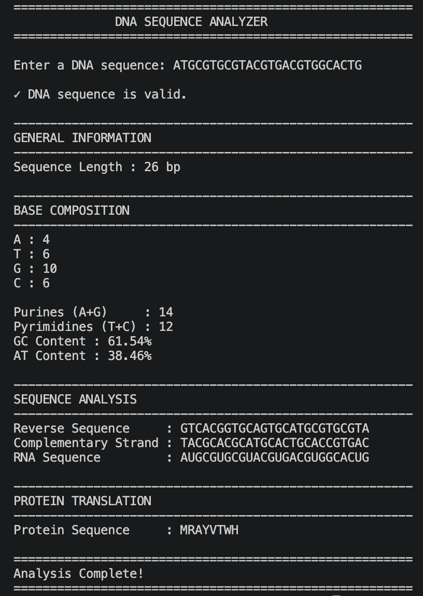

# DNA Sequence Analyzer

A Python command-line tool for inspecting a DNA sequence. It validates nucleotide input, reports composition and GC/AT content, generates reverse and complementary sequences, and translates the coding strand through an RNA intermediate.

## Quick start

Requires Python 3 and Git for the clone command. No third-party Python packages are required.

    git clone https://github.com/harshitmishra0310/bioinformatics-dna-analyzer.git
    cd bioinformatics-dna-analyzer
    python3 dna_sequence_analyser.py

Enter a plain DNA sequence when prompted. Lowercase input is converted to uppercase. Empty input and characters outside A, T, G and C are rejected.

## Example

Input: `ATGGCCATTGTAATGGGCCGCTGA`

| Result | Value |
|---|---|
| Length | 24 bp |
| A / T / G / C | 5 / 6 / 8 / 5 |
| GC content | 54.17% |
| AT content | 45.83% |
| Protein | MAIVMGR |

## Biological assumptions and limits

- Input represents a coding strand written 5′ to 3′. RNA is generated by replacing T with U.
- Translation uses the standard genetic code from the first nucleotide. It stops before the first stop codon and ignores an incomplete final codon; it does not search for an open reading frame.
- The complementary sequence is printed in input order, corresponding to the opposite strand in the 3′ to 5′ direction. It is not a 5′ to 3′ reverse complement.
- Input is one plain sequence. FASTA headers, internal whitespace and ambiguous bases such as N are not supported.

## Implementation

The analysis uses Python strings, nucleotide counts and a codon dictionary. The repository includes the script, example screenshots and an MIT license.
## Program preview

## Author

Harshit Mishra — B.Tech Bioinformatics student at Shoolini University.

## License

MIT License. See the license file in this repository.
